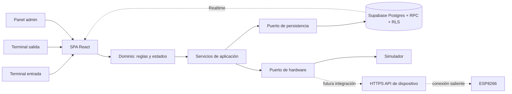

# Arquitectura

La UI no define reglas finales de capacidad. Con Supabase configurado, los cambios administrativos y del simulador pasan por RPC transaccionales y las vistas se actualizan con Realtime; la base es la fuente de verdad. Sin variables, la maqueta local sigue siendo efímera y aislada. La migración incremental todavía debe aplicarse para habilitar la persistencia compartida.

Las terminales conectadas se autentican con credenciales aleatorias aprovisionadas por un administrador y usan RPC. Una operación terminal queda pendiente hasta la confirmación del controlador; no se considera el navegador como fuente de sensor. El firmware ESP8266, la comunicación local de contingencia y la reconciliación offline quedan fuera de esta etapa. No se presupone modelo eléctrico ni pinout.
