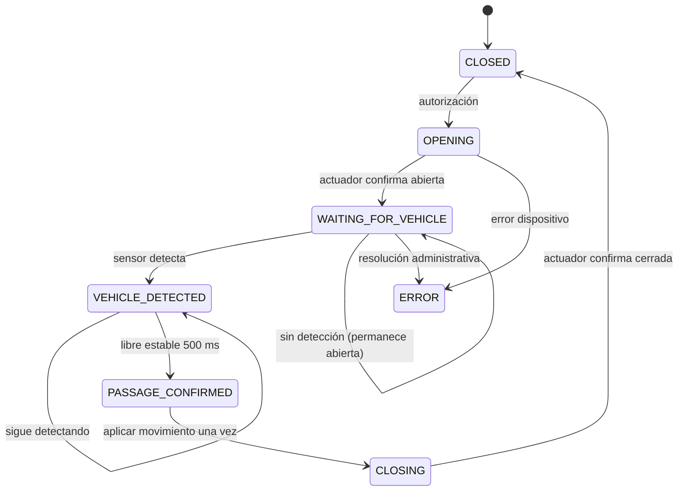

# Máquinas de estados

La entrada y salida poseen estados independientes. Apertura manual no contabiliza. Cierre manual requiere sensor libre y ausencia de operación de paso insegura. El simulador debe ejercitar la misma secuencia y evitar confirmaciones duplicadas.
